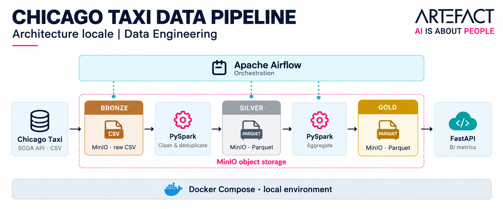
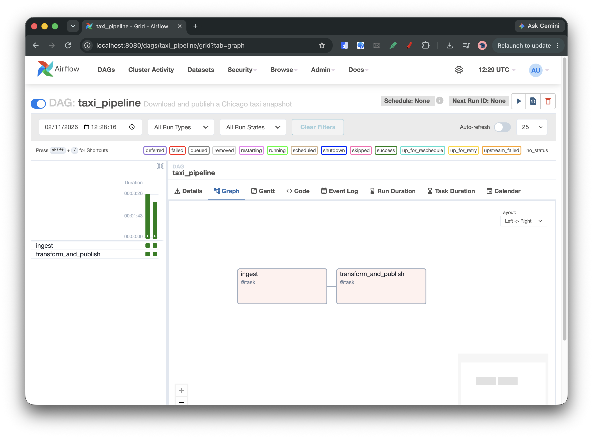
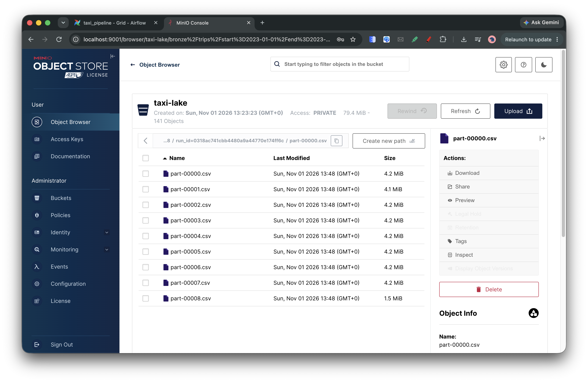
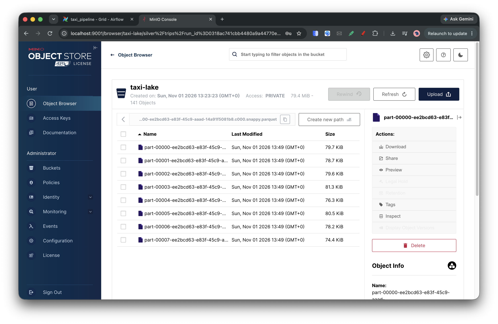
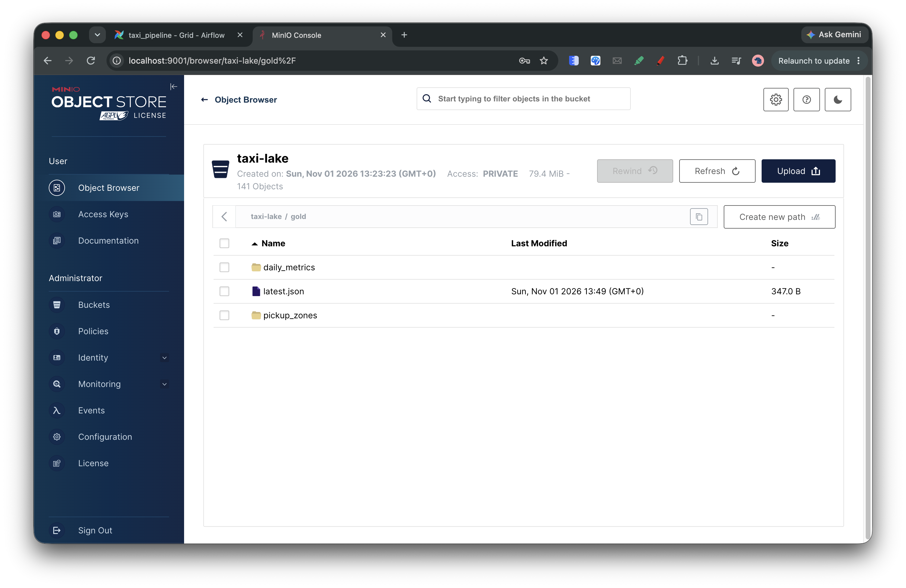

# Chicago Taxi — pipeline data local

Pipeline pour le [test technique Artefact](https://github.com/artefactory-ma/test_technique_data_engineer_ma). Il télécharge une période de trajets depuis l'API SODA, conserve les pages CSV brutes dans MinIO, les transforme avec PySpark et expose des agrégats via une API. **Apache Airflow** orchestre les deux étapes du DAG.

## Architecture




Chaque exécution écrit dans son propre répertoire. Le manifeste Gold n'est remplacé qu'après l'écriture des deux tables : l'API continue de lire la dernière exécution publiée si une exécution échoue. Les anciennes exécutions restent dans MinIO. L'API lit les fichiers Parquet directement depuis le stockage objet.

## Prérequis et lancement

- Docker Engine ou Docker Desktop avec Docker Compose v2 et un accès Internet pour construire l'image et accéder à SODA.
- Au moins 4 Go de mémoire disponibles pour Docker et de l'espace disque pour les CSV et les données MinIO.
- Ports locaux 8080, 8000, 9000 et 9001 disponibles ; ils sont liés à `127.0.0.1`.
- Par défaut le pipeline utilise l'API SODA v2 sans jeton. Un jeton est nécessaire pour utiliser v3.

À la racine du projet :

```bash
docker compose up --build -d
```

Si `docker compose` n'est pas reconnu sur macOS mais que Docker Desktop est installé, son binaire Compose peut être appelé directement :

```bash
/Applications/Docker.app/Contents/Resources/cli-plugins/docker-compose up --build -d
```

Dans ce cas, remplacer `docker compose` par ce chemin complet dans les commandes suivantes.

1. Attendre le démarrage d'Airflow et ouvrir <http://localhost:8080>.
2. Se connecter avec l'utilisateur `admin` et le mot de passe `admin` (identifiants de démonstration locale).
3. Dans la liste des DAGs, ouvrir `taxi_pipeline` et cliquer sur **Trigger DAG**. Les tâches `ingest` puis `transform_and_publish` téléchargent une nouvelle extraction, la déposent dans MinIO et exécutent Spark. Les logs de chaque tâche sont disponibles dans l'interface.
4. Après succès, consulter les résultats :

   ```bash
   curl -s http://localhost:8000/snapshot
   curl -s http://localhost:8000/metrics/daily
   curl -s 'http://localhost:8000/metrics/pickup-zones?limit=10'
   ```

Documentation interactive de l'API : <http://localhost:8000/docs>. Console MinIO : <http://localhost:9001> ; identifiants locaux par défaut `minioadmin` / `minioadmin`. Avant la première publication, l'API renvoie HTTP 503. Les données et l'historique Airflow persistent grâce aux volumes Docker. `docker compose down` arrête les services ; `docker compose down -v` supprime également les données et l'historique.

## Données et reproductibilité

Le jeu de données est [Chicago Taxi Trips 2013–2023](https://data.cityofchicago.org/Transportation/Taxi-Trips-2013-2023-/wrvz-psew). La période par défaut est **du 1er janvier 2023 inclus au 8 janvier 2023 exclu**. Le téléchargement utilise l'endpoint SODA v2 `resource/wrvz-psew.csv`, avec filtre sur `trip_start_timestamp`, pages de 10 000 lignes et tri par date de début puis `trip_id`. La source peut évoluer entre deux téléchargements : le tri stabilise la pagination, mais ne garantit pas une isolation transactionnelle pendant l'extraction.

La ville indique que les horaires sont arrondis au quart d'heure et que tous les trajets ne sont pas nécessairement déclarés. Les horodatages locaux sans fuseau sont utilisés tels quels pour le jour métier, sans conversion en UTC. Le script compare le nombre de lignes téléchargées au nombre de lignes lues par Spark.

### Extraction locale déjà téléchargée

Une extraction du **1er janvier 2023 inclus au 8 janvier 2023 exclu** a été téléchargée le 1er novembre 2026 dans `data/chicago_taxi_week/` : **83 667 trajets**, 9 pages, 35,14 MiB, 23 colonnes retournées par l'API. Les sommes SHA-256, les nombres de lignes et les bornes de dates ont été vérifiés ; les 83 667 identifiants sont distincts. Ces chiffres peuvent évoluer si la source est corrigée. Les données ne sont pas incluses dans Git.

Pour reproduire l'extraction localement avec Python 3.10 ou supérieur, sans Docker ni bibliothèque supplémentaire :

```bash
SSL_CERT_FILE=/etc/ssl/cert.pem SODA_API_VERSION=2 START_DATE=2023-01-01 END_DATE=2023-01-08 PAGE_SIZE=10000 \
  python3 -m pipeline.download --output-dir data/chicago_taxi_week
```

`SSL_CERT_FILE` désigne ici le bundle de certificats système de cette installation macOS et conserve la vérification TLS. Sur d'autres systèmes, omettre cette variable si Python possède déjà un bundle valide. Le dossier de sortie ne doit pas déjà exister ; choisir un autre chemin pour une nouvelle extraction. Le fichier `manifest.json` indique la source, la période, les colonnes, les nombres de lignes et les sommes SHA-256. En cas d'échec, aucun dossier de résultat partiel n'est conservé.

**Le DAG Airflow télécharge sa propre extraction SODA.** Il n'importe pas le dossier local décrit ci-dessus. Pour récupérer uniquement dans Bronze, sans exécuter Spark :

```bash
docker compose run --rm airflow python -m pipeline.download
```

Pour modifier la période ou utiliser SODA v3, copier `.env.example` en `.env`, adapter les valeurs, puis recréer les conteneurs avec `docker compose up --build -d`. `START_DATE` est inclus, `END_DATE` exclu, au format `YYYY-MM-DD` ; `PAGE_SIZE` est compris entre 1 et 50 000. `SODA_API_VERSION` vaut `2` par défaut. Si `SODA_API_VERSION=3`, fournir `SODA_APP_TOKEN` dans `.env` ou dans l'environnement : [instructions Socrata](https://dev.socrata.com/docs/app-tokens). Ne pas ajouter ce fichier à Git. Les variables sont lues au démarrage des conteneurs.

## Modèle et qualité

- **Bronze** : toutes les colonnes retournées par l'API sont conservées dans les pages CSV telles que reçues, regroupées par bornes d'extraction et identifiant de snapshot. Le script télécharge toutes les pages avant de commencer leur transfert ; les nouvelles données ne sont transmises à Spark que si le transfert complet a réussi.
- **Silver** : la transformation actuelle sélectionne 8 champs utiles : `trip_id`, `trip_start_timestamp`, `trip_seconds`, `trip_miles`, `pickup_community_area`, `fare`, `tips`, `trip_total`, puis ajoute `trip_date`. Ils sont typés et partitionnés par jour. Sont rejetées les lignes sans identifiant ou date valide, sans durée strictement positive, sans montant total positif ou nul, et celles dont les distances, tarifs ou pourboires renseignés sont négatifs. Les zones, tarifs, distances et pourboires peuvent manquer. Les doublons par `trip_id` sont ramenés à une ligne par un ordre déterministe sur le contenu typé ; les conflits ne sont pas fusionnés. Les comptages figurent dans le manifeste et les logs.
- **Gold** : `daily_metrics` donne le nombre de trajets, la somme de `trip_total` en dollars et la durée moyenne en secondes par jour ; `pickup_zones` donne le nombre de trajets et la somme de `trip_total` par code de zone de prise en charge renseigné. Les valeurs nulles de zone sont exclues de cette seconde table. L'API trie les zones par nombre de trajets décroissant.

Les montants sont manipulés en décimal. Les fichiers Silver et Gold sont en Parquet. Le bucket est créé automatiquement au premier run. Le pipeline échoue si l'extraction est vide, si le schéma attendu manque, si le comptage change ou si aucune ligne valide ne subsiste.

## Tests

Après construction de l'image :

```bash
docker compose run --rm airflow python -m unittest discover -s tests -v
```

Les tests couvrent les requêtes v2/v3, la pagination, les CSV contenant des retours à la ligne, la validation de la configuration, le nettoyage, la déduplication et les agrégations Spark.

Le 1er novembre 2026, un run réel d'Airflow a téléchargé 83 667 trajets, publié 81 952 lignes Silver et comptabilisé 1 715 lignes rejetées ou dédupliquées. L'API a renvoyé 7 jours dont la somme des trajets correspond à Silver, ainsi que les 10 principales zones. Les 13 tests ont réussi dans le conteneur Airflow ; la cohérence des dépendances et le redémarrage d'Airflow ont aussi été vérifiés. Ces résultats dépendent de la source à la date du run.

## Captures d’écran

### Exécution du DAG Airflow

Les deux tâches `ingest` et `transform_and_publish` ont terminé avec succès.



### Bronze : fichiers CSV bruts

Les pages CSV téléchargées sont conservées telles quelles dans MinIO.



### Silver : données nettoyées

Les trajets nettoyés et typés sont stockés au format Parquet.



### Gold : tables analytiques

La couche Gold contient les agrégats quotidiens et les zones de prise en charge, ainsi que le manifeste de la dernière publication.



## Choix et pistes d'amélioration

Airflow en mode `standalone` utilise SQLite et `SequentialExecutor` pour limiter les services nécessaires à la démonstration locale. Ce mode ne permet pas l'exécution parallèle et n'est pas adapté à la production. Spark s'exécute sur deux threads dans le conteneur. MinIO fournit une interface S3 et FastAPI une exposition légère. L'image MinIO est construite à partir du code source officiel épinglé à `RELEASE.2025-04-22T22-12-26Z` dans `Dockerfile.minio`, car les images utilisées précédemment ne sont plus accessibles publiquement. Le premier build télécharge les dépendances Go et peut être long.

Avec plus de temps : ajouter des tests d'intégration automatisés avec MinIO et une source SODA simulée, conserver davantage de colonnes en Silver, séparer les rejets et les doublons avec leurs motifs, ajouter des alertes et une politique de rétention, et utiliser un format transactionnel (Iceberg/Delta) pour les mises à jour incrémentales et la concurrence. Un vrai service BI nécessiterait une couche SQL, de l'authentification et une gestion des secrets adaptée.
